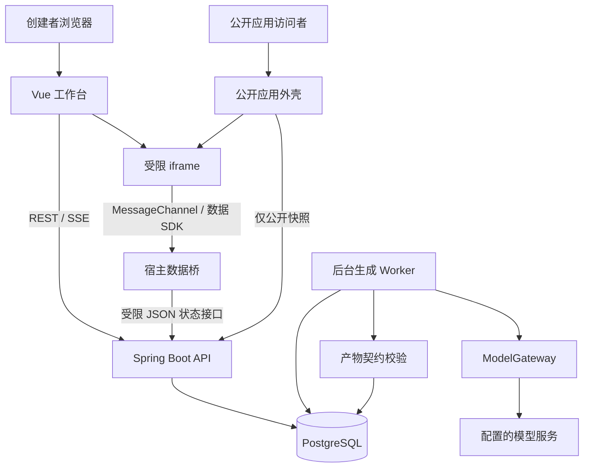
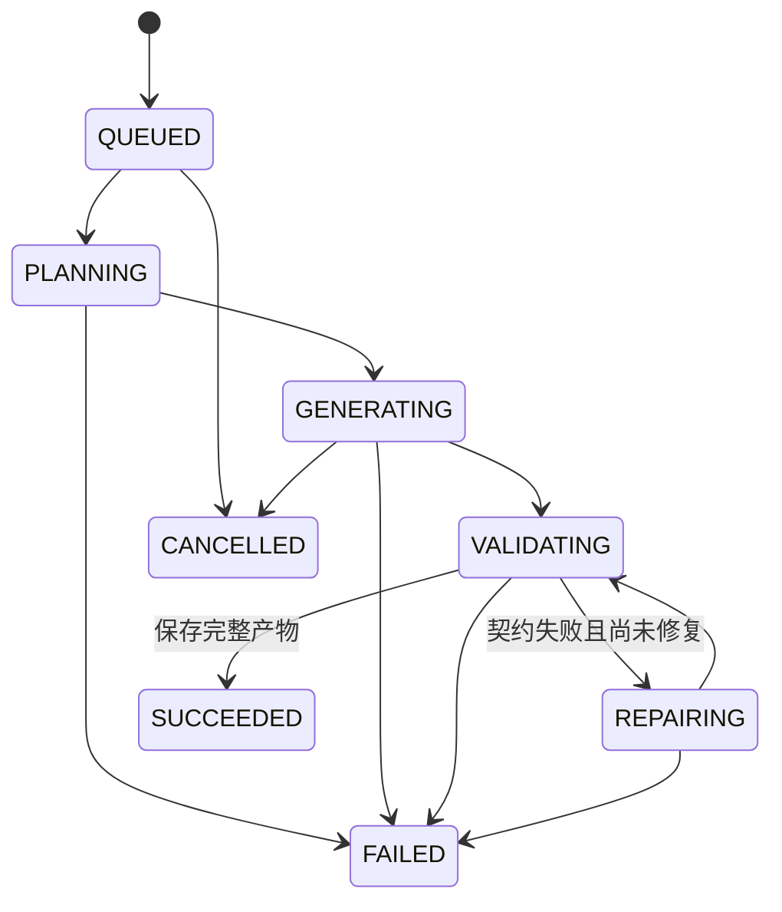

# 03 · 架构设计

实施基线更新：用户指定 Java 17.0.5-oracle；本地采用 Spring Boot 3.5.16 和已有 Node 24.20.0，见 [ADR-002](../decisions/002-local-java17-baseline.md)。后续功能和部署仍按任务清单逐项验收。

## 1. 架构结论与边界

推荐 **Java 17 + Spring Boot + Vue 3/TypeScript + PostgreSQL + Docker Compose**。采用模块化单体，后台有限并发执行生成任务，REST 提交指令、SSE 传递进度。

生成物首版为固定格式 HTML/CSS/JavaScript，在浏览器沙箱中运行；数据读写经宿主提供的受限 SDK 转发到平台。这样可以覆盖实际代码生成、可操作应用和持久化，同时避免在 6–8 小时里构建通用代码执行云。

这是 Demo 的设计，不是 Atoms 内部架构的逆向结论。

## 2. 技术栈比较

| 维度 | Spring Boot + Vue | Go + Vue | Node/TypeScript + Vue |
|---|---|---|---|
| 对用户偏好的符合度 | 最高，作为默认方案 | 可替代 | 未被优先提出 |
| REST、认证、数据访问 | 框架集成选择多 | 标准库与组合式库均可 | 全栈同语言，契约复用方便 |
| SSE 和取消控制 | SseEmitter + 后台任务上下文 | HTTP flush + context | 流与 AbortController 等方式 |
| LLM 对接 | 独立 HTTP 适配器即可 | 独立 HTTP 适配器即可 | 模型 SDK 选择多 |
| 小规模部署 | JVM 服务及数据库 | 编译后二进制及数据库 | Node 运行时及数据库 |
| 代码编译工具整合 | 若后期编译前端，增加独立 Node worker | 同样通常增加 Node worker | 同语言工具整合较直接 |
| 本项目主要成本 | 生成质量、预览、版本与任务一致性 | 同左 | 同左 |
| 推荐条件 | 熟悉 Java，重视按时交付 | Go 明显更熟，已有脚手架 | 已有可复用 TS 全栈基础 |

不以未经实测的性能倍数或内存数字做决策。Go 的部署形态有优势，但无法消除模型输出、前端运行和业务建模的复杂度。当前约束下，切换语言的学习与调试成本比 API 吞吐更值得关注。

Spring MVC 官方支持 `SseEmitter`；Go 的 `net/http` 提供流式 flush，`context` 提供取消和超时机制。以上证明两条路线都可实现，不证明任一方案在本 Demo 中更快。[Spring SSE](https://docs.spring.io/spring-framework/reference/web/webmvc/mvc-ann-async.html)、[Go HTTP](https://pkg.go.dev/net/http#Flusher)、[Go Context](https://pkg.go.dev/context)

### 建议的依赖基线

| 层 | 选型 | 使用范围 |
|---|---|---|
| 平台前端 | Vue 3 + TypeScript + Vite | 单页工作台 |
| 路由与状态 | Vue Router + Pinia | 项目、运行、UI 状态；服务端是真实来源 |
| UI | 自定义布局与 CSS variables，复用熟悉的基础组件库 | 控制新增依赖数量 |
| 代码视图 | 第一版只读高亮 | Monaco 可后加 |
| 语法检查 | 浏览器内 JS parser，例如 Acorn | 解析生成的经典脚本，不执行于宿主 |
| 后端 | Java 17 + Spring Boot 3.5.x 或已有经过验证的 Boot 基线 | MVC、任务、数据接口 |
| 数据访问 | Spring JDBC/JdbcClient + Flyway | 显式事务和约束 |
| 会话 | Spring Security + Spring Session JDBC | Cookie 会话与持久化 |
| 模型 | 自定义 ModelGateway + HTTP 客户端 | 先接通一个实际可用模型 |
| 数据库 | PostgreSQL | JSONB、项目和任务状态 |
| 入口部署 | 本地创作平台 + 独立公开网关 + ngrok 类 HTTPS 隧道 | 只公开已发布应用，见 ADR-008 |

访问时 Spring 3.5 文档列出 Java 17 为最低要求，并提示最新稳定系列为 4.1；这里偏向 3.5 是对熟悉度与既有依赖的选择，不表示它是最新系列或承诺长期支持。开工时锁定可下载、通过测试的补丁版本和镜像标签。[Spring 系统要求](https://docs.spring.io/spring-boot/3.5/system-requirements.html)

平台前端使用 Vite/SFC；Vue 官方同时支持无构建使用方式，但不能直接把 `.vue` SFC 交给浏览器运行。本 Demo 的生成物先用原生 HTML/CSS/JS，避免混淆两层。[Vue Quick Start](https://vuejs.org/guide/quick-start.html)

规划时终端默认 Node 为 v20.15.0；访问时 Vue Quick Start 要求 `^22.18.0 || >=24.12.0`。实施时发现本机已有 Node 24.20.0，已通过项目 `.nvmrc` 选定并完成构建验收，未修改全局默认版本。

## 3. 系统结构



运行边界：

- API 与 Worker 首版在同一 JVM，通过模块和接口分隔。
- PostgreSQL 保存源码快照；小产物不额外引入对象存储。
- SSE 不承担任务执行，仅反映数据库记录的进度。
- 生成代码不在 JVM、宿主 Vue DOM 或服务器 shell 中执行。
- 平台是全栈应用；生成应用使用平台数据服务，不拥有独立后端进程。

## 4. Agent 执行设计

### 4.1 首版采用有界工作流

| 阶段 | 实际执行 | 对用户展示 |
|---|---|---|
| Planner | 模型请求，输出目标、布局、交互、保留项和数据需求 | 需求摘要和短计划 |
| Builder | 模型请求，结合当前源码生成完整新产物 | 生成阶段和产物结果 |
| Validator | 程序检查 JSON、文件、体积、数据契约 | 明确检查项与结果 |
| Repair（条件触发） | 带真实校验错误的一次模型修正 | 修复原因和结果 |
| Persist | 事务保存产物、推进版本和运行状态 | 新版本卡 |
| Preview（浏览器） | 语法解析、加载和启动错误捕获 | 独立预览报告 |

Planner 与 Builder 可以使用同一模型的两次调用。Validator 是代码，不伪装为第三次智能体推理。准确命名为“角色分工的 Agent 工作流”；不宣称实现了自主多 Agent 群体。

工具边界预留 `readProjectSnapshot`、`validateArtifact`、`saveArtifact`。工作流调用这些真实功能并记录动作；首版不让模型自由执行 shell、安装依赖或修改服务器文件。

### 4.2 模型上下文

首次请求：系统契约、用户要求、可用 SDK、文件约束、初始数据约束、少量风格建议。

修改请求：以上内容 + 当前完整快照 + 新需求 + 必须保留的功能摘要。不会把所有历史源码版本全部塞入上下文；对于限制内的小应用，传当前快照比让模型对不可控 diff 做修补更简单。

真实业务数据不进入模型上下文，模型只接收数据结构和示例初始状态。上一轮消息与源码属于待处理数据，不能改变系统提供的工具权限。

### 4.3 模型接入契约

```java
interface ModelGateway {
    GenerationResult generate(
        GenerationRequest request,
        GenerationObserver observer,
        CancellationSignal cancellation
    );
}
```

具体适配器负责认证、流协议、JSON 输出能力、token 用量和取消机制。“兼容 OpenAI 接口”不能直接等同于所有流事件、结构化输出和工具调用都兼容；先验证实际供应商。模型 ID、URL、密钥来自服务端配置。

首版不要求引入 Spring AI/LangChain4j。若已有熟悉的可用模板，可在 ModelGateway 内部使用；对外任务与产物契约不受影响。

### 4.4 输出不完整时

- 仅接受完整 JSON 产物，流式碎片只用于状态反馈或服务端缓冲。
- JSON 解析失败、缺文件、超大小、违反契约：记录错误，最多一次修复。
- 额度不足、认证失败、明确限流：不做盲目模型重试。
- 上游超时可能已经产生费用；用户重试创建新 run，并保留失败 run。
- 不用固定模板静默替换真实生成失败。

## 5. 任务模型、事件和一致性



图中省略的运行阶段也可进入 CANCELLED、FAILED；服务重启时旧进程的活动任务进入 INTERRUPTED。SUCCEEDED 表示产物生成并保存完成，不表示功能已全面通过测试。

### 5.1 提交与执行

1. POST 请求先验证身份、项目归属、预算和输入。
2. 短事务锁定项目行，校验基线和当前活动任务；原子写入幂等记录、用户消息与 QUEUED run。
3. 返回 202/runId，不让 HTTP 提交请求等待整轮生成。
4. 固定数量 Worker 从数据库领取任务；领取事务先设置运行状态后提交，不在数据库事务中等待模型。
5. 同一项目最多一个活动 run；全局默认两个 Worker，并有限制的待处理队列。
6. 最终提交事务同时核对取消状态、activeRunId 和 projectRevision，然后写版本、更新 currentVersionId、释放活动标记并写终态事件。

领取可用 PostgreSQL 行锁或 `FOR UPDATE SKIP LOCKED` 实现；首版单实例不需要消息队列。数据库是任务真实来源，应用内队列只能是加速手段。

### 5.2 SSE

事件记录 `(runId, seq, type, payload, createdAt)`，`(runId, seq)` 唯一；seq 在对应 run 行锁内递增，避免取消事件与生成事件并发争用序号。阶段动作和结果先保存后通知；模型文本如需展示按小批次合并，不逐 token 写库。

最简单可靠的首版实现：SSE emitter 按游标定期读取事件表并发送；有新事件时可额外唤醒。连接初始读取、重连和尾随使用同一个游标规则，从而避免“查历史后订阅实时”的丢事件窗口。

客户端按 seq 去重；携带 Last-Event-ID 或 after 游标重连。每 15 秒发送心跳。代理关闭 SSE 缓冲并设置足够读取超时。客户端收到终态且补齐最后事件后关闭连接。

### 5.3 取消与重启

取消请求是服务端状态变更，不能仅关闭 SSE。它设置 cancelRequested，并尽力取消上游连接；每个阶段和最终提交都检查该标记。取消后晚到响应不得覆盖 currentVersionId。取消不保证上游退费。

关闭浏览器只断开观察，不取消任务。首版单实例启动时，将属于旧进程的非终态已执行任务标记为 INTERRUPTED，保留 QUEUED 任务继续处理。对于结果未知的上游调用不自动重新扣费执行。

未来多 Worker 实例再引入 lease、心跳和外部队列；首版不要把“启动时中断所有活跃任务”的方案直接用于多实例。

## 6. 生成物与运行机制

### 6.1 固定产物格式

四个逻辑文件：`view.html`（body 内容片段）、`styles.css`、`main.js`（经典脚本）、`manifest.json`（标题、初始状态、数据版本、摘要）。接口精确定义见 [04 接口与协议](04-api-contracts.md)。

默认不支持 npm 包、ES import、远程脚本、任意子 iframe、外部表单提交、任意网络请求。页面图形可用 CSS 和内联 SVG。后续可以加入平台固定版本资产，但不能让模型任意改 package.json。

源码总量建议限制 120 KiB，文件名为固定白名单；Prompt 上限与模型输出 token 上限分别配置。拒绝路径穿越和意外文件，而不是尝试把任意路径写到服务器。

### 6.2 可信外壳与不可信代码

工作台及公开 `/a/:slug` 都加载平台写的可信外壳，再创建：

```html
<iframe sandbox="allow-scripts" referrerpolicy="no-referrer"></iframe>
```

不设置 allow-same-origin、allow-top-navigation、allow-popups 等权限。iframe 的 src 指向平台专用的运行文档端点；该端点返回装配后的 HTML，并同时设置 HTTP `Content-Security-Policy: sandbox allow-scripts; ...`。这样即使运行文档 URL 被直接打开，仍有响应级沙箱。独立预览页也保留可信外壳。

沙箱的独立来源限制会影响 Cookie/localStorage；本设计不依赖 iframe 自己的本地存储。[MDN iframe](https://developer.mozilla.org/en-US/docs/Web/HTML/Reference/Elements/iframe)

服务端装配器负责可信 head、CSP、错误桥和 SDK。HTML 使用解析后的受限 body 片段；CSS 与 JS 通过经过转义的序列化数据或 Blob 注入，避免简单拼接造成 `</script>` 提前闭合。生成代码只在运行文档执行，不能被 Vue `v-html` 放入宿主。

### 6.3 预览防护与准确边界

运行文档使用响应级受限 CSP：sandbox allow-scripts；默认拒绝资源，脚本仅允许生成文档需要的 inline/blob，样式允许 inline，图片限 data，禁止 connect、object、frame、form-action 和 base-uri。运行端点只允许被本平台框架嵌入，其他管理页禁止被嵌入。宿主自己的 CSP 单独配置，避免把预览所需宽松项加到整个管理页面。

不默认使用 srcdoc，是因为它与宿主 CSP 的继承关系容易造成脚本无法运行；子文档新增 meta CSP 不能放宽已经继承的限制。使用独立 HTTP 文档及响应头可以明确各自策略。预览文档需所有者鉴权，公开运行文档只从已发布版本生成；两者不携带平台秘密。[CSP 继承规则](https://www.w3.org/TR/CSP3/#csp-inheriting-to-avoid-bypasses)

CSP 的 sandbox 必须通过 HTTP 响应头设置，不能用 meta 或 Report-Only 替代。反代的通用安全头需要为运行端点作精确配置，避免叠加一个禁止脚本或禁止 iframe 嵌入的策略导致预览失效。[CSP sandbox 文档](https://developer.mozilla.org/en-US/docs/Web/HTTP/Reference/Headers/Content-Security-Policy/sandbox)

这套措施降低生成内容影响平台 DOM、凭据与网络接口的风险，但**不构成通用恶意代码隔离环境**：iframe 可能阻塞浏览器执行，复杂导航与浏览器能力不能仅靠这些配置全面封锁。首版只为小型生成应用设计，不能据此承诺强 CPU 限额或完整网络隔离。上线扩大使用范围前再建设独立预览域和受控浏览器执行环境。

### 6.4 宿主通信

iframe 使用 `postMessage` 与宿主建立 MessageChannel。宿主核对 iframe.contentWindow、一次性 channelId、消息结构和当前版本，之后仅接受该 port 的允许操作。每次切换版本、刷新或销毁 iframe 都关闭旧 port 并失效旧上下文。

无 allow-same-origin 的文档通常报告 opaque origin，不能只以 `origin === "null"` 作为授权。向 opaque iframe 初始化发送可能需要 `*`；只发送桥接初始化数据，绝不发送 Cookie、模型密钥或管理 token。iframe 发向宿主时使用确定的宿主 origin；双方核对 source/channel。通道标识用于防混线，不是恶意生成代码与可信 SDK 之间的秘密。[MDN postMessage](https://developer.mozilla.org/en-US/docs/Web/API/Window/postMessage)

数据桥只允许当前项目的状态读取和保存，不提供任意 URL fetch、任意 SQL、项目查询、发布或模型调用。后端再次验证真实会话与项目范围，不能依赖前端过滤实现授权。

### 6.5 预览检查与修复

前端先解析 main.js 语法，错误直接展示；然后装配运行，捕获 error/unhandledrejection，SDK 的 ready 回调完成后报告启动状态。

`iframe.onload` 只代表加载事件发生，不能单独证明应用正常。平台将检查结果记录为 UNKNOWN、PASSED 或 FAILED；PASSED 仅表示指定启动检查通过，不等于全部业务正确。[MDN iframe 的事件行为](https://developer.mozilla.org/en-US/docs/Web/HTML/Reference/Elements/iframe)

关闭浏览器时后台生成可以 SUCCEEDED，但预览仍 UNKNOWN。P0 用户打开后检查；P1 可把真实错误连同对应版本发起新的修复 run。无需为了展示自动修复在服务器临时执行模型生成的脚本。

## 7. 数据持久化

### 7.1 两层数据

平台元数据：项目、消息、任务、事件、源码版本、发布记录。

生成应用数据：每个项目、环境、访问者的一份 JSON 状态。初期限制为 256 KiB，支持 revision 条件写入。此设计适合待办等小应用，不是任意数据库建模平台。

### 7.2 逻辑表

| 表 | 关键字段 | 约束/用途 |
|---|---|---|
| users | id、is_guest、email?、password_hash?、display_name | 访客和可选账号统一身份 |
| projects | id、owner_id、name、current_version_id、active_run_id、revision | 所有访问检查 owner |
| messages | id、project_id、run_id?、role、content、created_at | 当前项目对话 |
| runs | id、project_id、base_version_id、status、cancel_requested、attempt、error、usage | 每次生成的可追踪记录 |
| run_events | run_id、seq、type、payload、created_at | UNIQUE(run_id, seq)，重放索引 |
| versions | id、project_id、version_no、source_json、content_hash、based_on_id、restored_from_id?、run_id? | UNIQUE(project_id, version_no)，源码不可变 |
| preview_reports | id、version_id、actor_id、status、errors、created_at | 与不可变源码分离的检查记录 |
| publications | project_id、slug、version_id、status、revision、updated_at | project_id/slug 唯一，显式发布指针 |
| app_states | project_id、environment、actor_id、schema_version、value、revision | UNIQUE(project_id, environment, actor_id) |
| idempotency_records | actor_id、method、resource、key、request_hash、response | 唯一约束保障意图去重 |
| Spring Session 表 | 框架定义 | 会话可跨应用重启恢复 |

所有时间使用 UTC 存储，客户端本地化。源码可以 TEXT/JSONB 保存；源码 hash 用于比对，不作为版本唯一键，因为恢复可能产生相同源码的新版本。

### 7.3 状态读写语义

键为 `(projectId, PREVIEW|LIVE, actorId)`。

- PREVIEW：必须是项目所有者，工作台使用当前或候选版本的数据契约。
- LIVE：项目必须已发布，actorId 由服务端会话确定，不能由 iframe 指定。
- 第一次读取没有记录时返回当前加载版本的 initialState；首次保存使用 expectedRevision=0 原子插入。
- 后续保存使用 UPDATE ... WHERE revision=expectedRevision，成功后 revision+1；无匹配行返回 409。
- 页面修改先展示“保存中”，收到成功才展示“已保存”；错误保留用户输入。
- 预览与线上数据完全分区；发布不复制预览数据，更新不重置线上数据。

写请求携带 loadedVersionId，后端核对当前可写版本。公开版本已更新但旧标签仍运行时，返回 STALE_APP_VERSION，要求刷新后重试，避免旧代码覆盖新结构。

P0 所有版本保持 stateSchemaVersion=1，只允许兼容性新增字段并提供默认值。复杂 schema migration 后置；若更改不兼容，不能自动清空数据“修复”。

### 7.4 恢复与数据

恢复复制历史源码为新版本，更新 currentVersionId；业务数据与 publications 不变。历史只读预览采用 initialState，明确标注“历史示例数据”。这能避免旧应用逻辑对当前数据造成副作用。

## 8. API、身份与额度边界

- 创作端与公开端分入口，各自保持前端/API 同源。公开端只转发白名单路径，不代理创作 API；HTTPS 会话 Cookie 为 HttpOnly、Secure、SameSite，不向生成代码暴露会话值。本地 HTTP 开发与公网 Cookie 配置须分开验证。
- 写接口校验 CSRF token；启动会话前从允许公开访问的 CSRF 获取接口领取。
- Spring Security 负责会话、密码验证和安全上下文；所有项目查询仍检查 ownerId。
- 模型密钥仅在服务端环境；供应商 URL 由部署配置指定，不接受访客提交任意地址。
- 全局并发、单身份任务数、全局日生成预算和输出 token 上限可配置。访客可清理 Cookie，因此访客限额不能被当作完整防滥用机制；全局预算是演示额度的最后边界。
- 公开应用的数据操作不调用 LLM，因此正常访客使用不会逐次产生生成费用。

建议初始边界：每项目一个活动 run、全局两个生成任务、最多一次修复、整轮约 5 分钟截止时间，具体时限通过模型烟测调整。这些是配置建议，非测量结果。

## 9. 部署结构与运行条件

2026-10-07 用户明确：创作平台不开放公网，仅已发布的用户应用需要公网链接。以下替代原全站云部署目标，详见 [ADR-008](../decisions/008-local-studio-public-apps.md)；公开网关和隧道尚未实现。

```text
本地创作者 → 127.0.0.1:5173 → backend:8080 → LLM API / PostgreSQL
公网访问者 → ngrok HTTPS → 127.0.0.1:8090（计划独立网关）
                            ├─ /a/:slug + 公开外壳资源
                            ├─ 公开应用 API + 必需的访客/CSRF 接口 → backend
                            └─ 其他路由/方法 → 拒绝（无创作 SPA fallback）
```

独立发布应用首版走 `/a/:slug`，不为每个项目启动服务进程。公开外壳只下载 publication 指定的快照，缓存必须随版本键变化；发布元信息短缓存或不缓存，避免更新后仍取旧指针。

数据库不暴露到公网；容器重建保留数据卷。日志包含 runId、阶段、耗时、错误类型和供应商用量，不默认记录完整提示、源码、密钥和业务数据。

无需 Redis、Kubernetes、向量数据库、独立消息中间件。不直接转发 5173/8080/5432 或测试端口；端口不同不等于安全隔离，还要验证路径/方法白名单、服务端鉴权、转发头、Cookie 和 CSP。生成与 SSE 留在本地，公网使用应用不触发模型请求。

实际接入时需要本地配置隧道凭据与可用 HTTPS 域名，再做外部网络验收；不在聊天中提供 token。本机休眠、关机、断网会使链接不可访问，免费隧道可能有提示页及额度限制。没有将本地隧道描述为持续托管服务。

## 10. 项目目录建议

```text
atoms-demo/
  backend/
    src/main/java/.../
      identity/ project/ artifact/ run/ model/ preview/ publication/ appdata/
    src/main/resources/db/migration/
    src/test/java/...
    pom.xml
  frontend/
    src/pages/ components/ stores/ api/ runtime/
    src/runtime/bridge.ts
    package.json
  e2e/
  deploy/
    compose.yaml
    nginx.conf
  docs/
  .env.example
  README.md
```

以上是计划中的代码目录，不是本次已创建的工程。后续构建应提供可执行命令，例如 `npm --prefix frontend ci`、`npm --prefix frontend run build`、`./backend/mvnw -f backend/pom.xml verify`、`docker compose -f deploy/compose.yaml up -d --build`。这些命令依赖相应脚手架和配置完成，当前文档阶段不可当作已验证的启动指南。

详细开发计划进一步明确：运行 HTML 由后端 RuntimeDocumentService 统一装配，前端 runtime 负责语法检查和消息桥，不另建重复的 HTML 拼装器。具体步骤与文件职责见 [开发任务](tasks/todo.md)。

## 11. 测试与可观察性

重点验证真实风险：重复提交只创建一轮、取消不被晚到结果覆盖、版本基线冲突、越权读取失败、状态 revision 冲突、公开指针不随编辑变化、刷新后事件补齐。

前端验证桥消息 source/channel/schema、语法错误状态、预览切换关闭旧端口；端到端走“生成 → 修改 → 保存数据 → 发布 → 无痕访问”。真实模型测试与固定模型桩分开：桩用于可重复逻辑验证，实际质量必须由真实生成证明。

可记录首阶段耗时、整轮耗时、成功/失败/取消、修复次数、供应商 usage、预览错误数。无须在首版引入复杂监控堆栈。

## 12. 扩展路线

1. **更好的生成体验**：截图输入、主题规范、文件 diff、点选修改；先保持单项目串行执行。
2. **Vue SFC 生成**：固定依赖和模板，独立 Node 编译 worker；编译产物再进入预览沙箱。
3. **应用数据平台化**：集合/记录级 API、真实应用账号、权限、迁移和备份；替换当前 JSON 状态适配器。
4. **独立后端生成**：产物增加受限后端文件与迁移；通过沙箱构建，运行容器独立资源限制、无宿主 Docker socket、受控网络及短期凭据。
5. **平台扩容**：API/Worker 分离、持久队列、任务 lease、对象存储、独立预览域、配额计量。

若改用 Go，可保留 REST/SSE、产物、SDK、数据库和前端契约；替换 API 实现、会话组件与任务控制。不要在笔试阶段同时维护两套后端。
